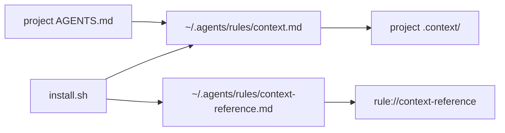

# Architecture

## Map

## Components
| 컴포넌트 | 책임 | 진입점 | 의존성 |
|---|---|---|---|
| `install.sh` | `home/.agents/`를 `~/.agents/`로 복사 | `bash install.sh` | bash, curl/tar(원격) |
| `home/.agents/rules/context.md` | 프로젝트별 선택 적용 컨텍스트 프로토콜 | 프로젝트 `AGENTS.md` | 파일 접근 |
| `home/.agents/rules/context-reference.md` | 템플릿·스키마 rulebook | `rule://context-reference` | omp |
| `README.md` | 설치·사용법 | - | - |
| `AGENTS.md` | 이 저장소 자체 진입 규칙 | - | - |

## Data flow
`install.sh` → `~/.agents/` → 프로젝트 `AGENTS.md`가 `context.md` 읽기 지시 → 프로젝트 `.context/` 작성·갱신. 위임 시 서브에이전트에도 읽기 지시를 전달한다.

## Boundaries
- 프로젝트가 `AGENTS.md`를 통해 규칙을 선택한다. 파일이 없으면 적용할 수 없다.
- `context-reference.md`는 omp rule discovery로 제공된다.
- `~/.agents/skills/` 등 무관한 파일은 보존한다.

## Invariants
- `context.md`는 자동 주입되지 않는다.
- `context-reference.md`는 `description` + `globs: .context/**` rulebook.
- 배포 규칙은 `.context/journal/` 문서를 한국어로, 나머지 `.context/` 문서는 영어로 작성하도록 한다.
- `journal/`은 task당 1파일, `journal/INDEX.md`는 전체 목록.
- `DECISIONS.md`는 직접 읽는 기본 문서이며 탐색에 필요하면 분할할 수 있다.

## Reading path
1. `README.md`
2. `home/.agents/rules/context.md`
3. `home/.agents/rules/context-reference.md`
4. `install.sh`
