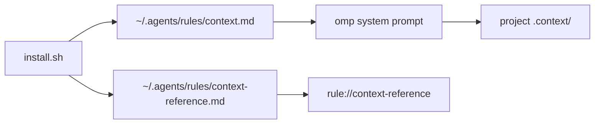

# Architecture

## Map

## Components
| 컴포넌트 | 책임 | 진입점 | 의존성 |
|---|---|---|---|
| `install.sh` | `home/.agents/`를 `~/.agents/`로 복사 | `bash install.sh` | bash, curl/tar(원격) |
| `home/.agents/rules/context.md` | alwaysApply 컨텍스트 프로토콜 | omp rule discovery | omp |
| `home/.agents/rules/context-reference.md` | 템플릿·스키마 rulebook | `rule://context-reference` | omp |
| `README.md` | 설치·사용법 | - | - |
| `AGENTS.md` | 이 저장소 자체 진입 규칙 | - | - |

## Data flow
`install.sh` → `~/.agents/` → omp discovery → 시스템 프롬프트(`<generic-rules>`) + rulebook 목록 → 프로젝트 `.context/` 작성·갱신.

## Boundaries
- omp의 rule discovery(`~/.agents/rules/*.md`)에 의존한다.
- 프로젝트에는 정적 규칙 파일을 복사하지 않는다.
- `~/.agents/skills/` 등 무관한 파일은 보존한다.

## Invariants
- `context.md`는 `alwaysApply: true`.
- `context-reference.md`는 `description` + `globs: .context/**` rulebook.
- `.context/` 문서는 한국어, 규칙·템플릿 파일은 영어.
- `journal/`은 task당 1파일, `journal/INDEX.md`는 전체 목록.
- `DECISIONS.md`는 단일 파일.

## Reading path
1. `README.md`
2. `home/.agents/rules/context.md`
3. `home/.agents/rules/context-reference.md`
4. `install.sh`
