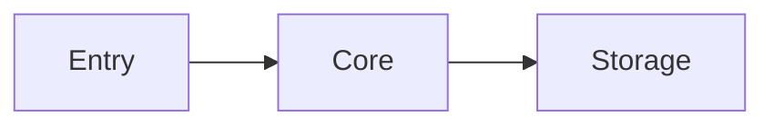

# Context Reference

Read this when creating or updating `.context/` documents. Write `journal/` documents in Korean, translating the journal templates below, and all other `.context/` documents in English. Keep code identifiers, paths, commands, and external API names as-is.

## INDEX.md

The reading map. List files and when to read them. Do not list tasks here.

```markdown
# Context Index

| File | Purpose | When to read | Last verified |
|---|---|---|---|
| [PROJECT.md](PROJECT.md) | Purpose, direction, non-goals | Always | 2026-11-15 |
| [ARCHITECTURE.md](ARCHITECTURE.md) | System map, data flow, invariants | Always | 2026-11-15 |
| [GLOSSARY.md](GLOSSARY.md) | Terms and contracts | Always | 2026-11-15 |
| [CONVENTIONS.md](CONVENTIONS.md) | Build, test, style, constraints | When work style matters | 2026-11-15 |
| [DECISIONS.md](DECISIONS.md) | Decisions and reasons | When changing or questioning a decision | 2026-11-15 |
| [modules/](modules/) | Module details | When touching that module | 2026-11-15 |
| [journal/INDEX.md](journal/INDEX.md) | Completed work | When investigating past work | 2026-11-15 |
```

## PROJECT.md

```markdown
---
last_verified: 2026-11-15
verified_against: <commit>
---

# Project

## Why
Why this project exists. The problem it solves.

## Users
Who uses it, and in what situation.

## Scope
What is included.

## Non-goals
What is explicitly excluded. The test for rejecting direction-changing requests.

## Direction
- Now: current focus.
- Next: next up.
- Later: directional only.

## Success criteria
How success is judged.
```

## ARCHITECTURE.md

````markdown
---
last_verified: 2026-11-15
verified_against: <commit>
---

# Architecture

## Map


## Components
| Component | Responsibility | Entry point | Dependencies |
|---|---|---|---|
|  |  |  |  |

## Data flow
Input → processing → storage → output. Core paths only.

## Boundaries
External systems, process boundaries, trust boundaries.

## Invariants
Rules that must not break. Things that exist only in comments or nowhere.

## Reading path
The order to read the source: 3–5 files or symbols.
````

## GLOSSARY.md

```markdown
---
last_verified: 2026-11-15
verified_against: <commit>
---

# Glossary

| Term | Definition | Source of truth |
|---|---|---|
|  |  | `path/to/file.go:Symbol` or "not in code" |
```

Domain terms, acronyms, external system names, contracts, and invariants. Link to code for type and function descriptions.

## CONVENTIONS.md

```markdown
---
last_verified: 2026-11-15
verified_against: <commit>
---

# Conventions

## Build
## Test
## Style
## Constraints
Environment, versions, prohibitions, external constraints.
```

## DECISIONS.md

One file, directly readable. Keep a table of all decisions at the top and one section per decision below. Use `ADR-NNN` IDs. Split by subject or year when this improves navigation, keeping `DECISIONS.md` as the index.

```markdown
---
last_verified: 2026-11-15
---

# Decisions

| ID | Date | Status | Decision |
|---|---|---|---|
| ADR-001 | 2026-11-15 | accepted | ... |

## ADR-001: Title

### Context
### Decision
### Alternatives
### Consequences
### Status
accepted | superseded | rejected
```

## journal/YYYY-MM-DD-task-name.md

```markdown
---
date: 2026-11-15
status: done | in-progress | blocked | abandoned
tags: [build, versioning]
related: [DECISIONS.md#adr-001]
---

# 2026-11-15: Task name

## Objective
## Background
## Changes
## Decisions
## Verification
Commands run and their results. "Not run" if not executed.
## Remaining
```

## journal/INDEX.md

A full task table grouped by month. Older tasks stay here so they remain findable.

```markdown
# Journal Index

## 2026-11
| Date | Task | Status | Tags |
|---|---|---|---|
| 2026-11-15 | [Build script versioning](2026-11-15-build-script-versioning.md) | done | build, versioning |
```

## modules/<name>.md

```markdown
---
last_verified: 2026-11-15
verified_against: <commit>
---

# <name>

## Responsibility
## Interface
## Dependencies
## Invariants
## Reading path
```
